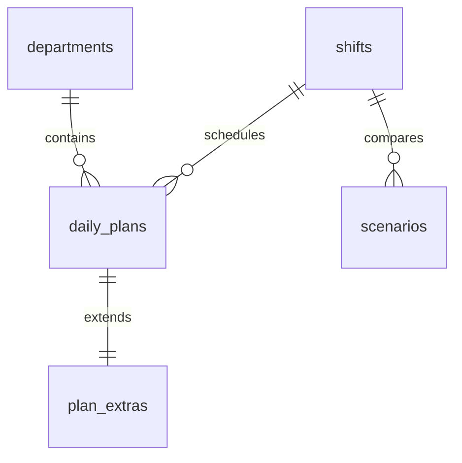

# Extended data dictionary

## Relationships

Saved scenarios contain JSON snapshots of all selected department plans. The audit log records before/after JSON for edits; its entity ID may identify either a plan or scenario depending on action.

| Table | Field group | Meaning |
| --- | --- | --- |
| departments | department_id, department_name | Picking, Packing or Dispatch |
| shifts | shift_id, shift_name, start_time, end_time | Eight-hour Day/Late shifts |
| daily_plans | plan_id | Unique planning record |
| daily_plans | plan_date, department_id, shift_id | Unique date/department/shift |
| daily_plans | forecast_cases | Expected cases, integer ≥ 0 |
| daily_plans | available_staff | Derived headcount: scheduled minus absent |
| daily_plans | cases_per_person_hour | Positive assumed productivity |
| daily_plans | productive_hours | Productive hours/person before overtime; excludes breaks |
| daily_plans | version | Incremented when a record changes; prevents stale edits |
| plan_extras | scheduled_staff, absent_staff | Headcounts; absent cannot exceed scheduled |
| plan_extras | paid_hours | Regular paid hours per available person |
| plan_extras | overtime_hours | Extra productive and paid hours per person, 0–4 |
| plan_extras | hourly_cost, overtime_rate | Fictional GBP rates |
| plan_extras | dispatch_deadline | Same-day local deadline after shift start |
| plan_extras | actual_cases, actual_staff | Nullable performance values; seeded figures are simulations |
| plan_extras | actual_productive_hours, actual_finished_at | Nullable actual time and finish |
| scenarios | scenario_name, plan_date, shift_id, created_at | Comparison metadata |
| scenarios | base_json, proposed_json, result_json | Immutable stored calculation snapshots |
| audit_log | changed_at, action, entity_id, before_json, after_json | Edit history without MySQL credentials |

Calculations are computed by Python, not duplicated in stored records. Actual-case variance is actual cases minus forecast. Shortfall uses theoretical capacity, not actual output. Aggregate coverage is total capacity divided by total forecast; it does not remove departmental shortages.
